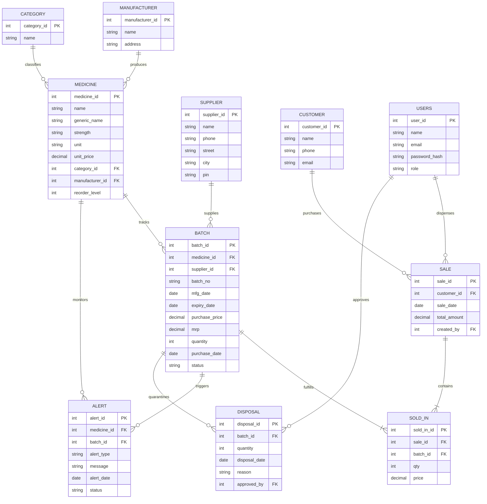

# MedStock Pro Pharma — Medicine Expiry & Stock Alert System

[](https://nodejs.org/)
[](https://expressjs.com/)
[](https://www.mysql.com/)
[](https://developer.mozilla.org/)
[](LICENSE)

An enterprise-grade, full-stack pharmaceutical inventory and safety management platform engineered to eliminate drug expiry losses, enforce clinical compliance, automate regulatory disposal tracking, and guarantee strict **FEFO (First-Expiry-First-Out)** dispensing at the database level.

---

## Table of Contents
1. [Project Overview](#project-overview)
2. [Key Capabilities & Features](#key-capabilities--features)
3. [System Architecture](#system-architecture)
4. [Technology Stack](#technology-stack)
5. [Database Design & DBMS Highlights](#database-design--dbms-highlights)
6. [Role-Based Access Control (RBAC)](#role-based-access-control-rbac)
7. [Getting Started & Local Setup](#getting-started--local-setup)
8. [Environment Configuration (.env)](#environment-configuration-env)
9. [REST API Specification](#rest-api-specification)
10. [Business Rules Enforced](#business-rules-enforced)
11. [Troubleshooting & FAQ](#troubleshooting--faq)

---

## 1. Project Overview

Hospitals and retail pharmacies face severe regulatory, financial, and patient safety risks when managing pharmaceutical inventory manually:
* **The Problem:** Dispensing expired medicine can be fatal, while holding stock until it expires costs pharmacies thousands in direct financial losses. Furthermore, inventory handlers often sell whatever batch is in front rather than prioritizing batches closest to expiration.
* **The Solution:** MedStock Pro tracks medications **batch-by-batch** with hard database constraints. Expired stock can never be sold, batches close to expiry trigger automated multi-tier warnings, and stock is automatically decremented from earliest-expiring batches using **First-Expiry-First-Out (FEFO)** algorithm.

---

## 2. Key Capabilities & Features

### 📦 1. Batch-Level Inventory Inwarding
* Logs unique batch numbers, manufacturing dates, expiry dates, purchase rates, MRP, and quantities.
* Database triggers reject any incoming batch with less than 30 days of shelf life.

### 🛡️ 2. Automated FEFO Dispensing (First-Expiry-First-Out)
* When a sale is processed, the system automatically draws stock from the earliest-expiring active batch first, seamlessly spilling over into subsequent batches if needed.
* Eliminates accidental sale of old stock and minimizes shelf aging.

### ⚠️ 3. Multi-Tier Expiry & Stock Alert Engine
* Automated alert thresholds: **90 Days**, **60 Days**, **30 Days**, and **7 Days Critical**.
* Real-time automated stock status calculation: `OUT_OF_STOCK`, `LOW_STOCK` (against reorder thresholds), `EXPIRING_SOON`, and `EXPIRED`.
* Scheduled background cron job (`00:05` daily) scans and updates quarantine flags.

### ☣️ 4. Clinical Disposal Authorization
* Expired batches are automatically quarantined.
* Statutory destruction sign-off requires dual authorization by a licensed clinical officer (`Pharmacist` or `Admin`).
* Logs destruction method (*Incineration*, *Return to Supplier*, *Chemical Destruction*) with full audit traceability.

### 👥 5. Role-Based Access Control & Password-Protected Switching
* Role segregation across **Administrator**, **Pharmacist**, and **Store Keeper**.
* Interactive password verification modal when switching user profiles from the top bar.
* Default fallback passwords: `admin123` (Admin) and `staff123` (Staff).

### 🌓 6. Modern Responsive UI
* Vanilla CSS design system with glassmorphism, responsive data tables, live search/filtering, and seamless **Dark / Light mode** toggling.

---

## 3. System Architecture

```text
[ Browser / Client ]
      │
      ▼ HTTP (fetch API + JWT Bearer Token)
[ Express.js REST API Server (Port 5000) ]
      ├── Middleware: CORS, JSON parser, Morgan logging
      ├── Auth Layer: JWT verification (auth.js) & Role guards
      ├── Cron Engine: node-cron (Daily alert generation at 00:05)
      └── Database Connection Pool (mysql2/promise, 10 connections)
            │
            ▼ TCP Socket (SSL Encrypted on Cloud)
[ MySQL 8.0 Database (pharmacy_db) ]
      ├── 11 Relational Tables (PK/FK Constraints, ON DELETE CASCADE)
      ├── 4 Safety Triggers (trg_check_batch_expiry, trg_sold_in_after_insert, etc.)
      └── Parameterized Prepared Statements (Zero SQL Injection)
```

---

## 4. Technology Stack

* **Backend:** Node.js (v18+), Express.js 4.19
* **Database:** MySQL 8.0 with `mysql2/promise` (native async/await connection pooling)
* **Authentication & Cryptography:** `jsonwebtoken` (JWT), `bcryptjs` (salt rounds = 10)
* **Automation:** `node-cron` for scheduled background alert scanning
* **Frontend:** Vanilla HTML5, Modern CSS3 (CSS Variables, Flexbox/Grid, Dark/Light modes), Modern Vanilla JavaScript (ES6+ Modules, async/await, DOM delegation)
* **Configuration:** `dotenv` (Twelve-Factor App architecture)

---

## 5. Database Design & DBMS Highlights

The relational schema is defined in [database/schema.sql](file:///c:/Users/Shubham%20Sanap/Desktop/medicine-expiry-system/database/schema.sql).

### Entity-Relationship Diagram (11 Tables)



### Academic & DBMS Showcase Features
1. **Connection Pooling**: Implemented via `mysql2/promise` with `connectionLimit: 10`, reusable connections, and queue overflow protection.
2. **Prepared Statements**: Parameterized SQL queries (`pool.query(sql, [params])`) prevent SQL injection attacks.
3. **Database Triggers**:
   * `trg_check_batch_expiry`: Prevents inserting expired batches upon stock-in.
   * `trg_prevent_expired_sale`: Throws `SIGNAL SQLSTATE '45000'` if any sale attempts to dispense an expired or inactive batch.
   * `trg_sold_in_after_insert`: Automatically decrements batch stock quantity upon transaction completion.
   * `trg_disposal_after_insert`: Deducts quantity and updates batch status to `DISPOSED` when inventory is written off.
4. **Relational Integrity**: Foreign keys with `ON DELETE CASCADE` on transient entities (alerts, line items) and audit preservation reassignment for historical sales.

---

## 6. Role-Based Access Control (RBAC)

| Module / Operation | Administrator (`admin`) | Pharmacist (`pharmacist`) | Store Keeper (`storekeeper`) |
| :--- | :---: | :---: | :---: |
| **Dashboard & Financials** | Full Access | Full Access | Read-Only (Stock Focus) |
| **Medicines Catalog** | CRUD | CRUD | Read-Only |
| **Suppliers & Categories** | CRUD | CRUD | Read-Only |
| **Customer Registry** | CRUD | CRUD | Lookup Only |
| **Batch Stock-In** | Inward & View | Inward & View | **Primary Operator** |
| **FEFO Dispensing & Sales** | Authorized | **Primary Operator** | ❌ Restricted |
| **Expiry Alerts & Quarantine**| Monitor & Resolve | Monitor & Resolve | Monitor Only |
| **Disposal Sign-off** | **Authorized** | **Authorized (Clinical)** | ❌ **Restricted** |
| **User Account Management** | **Full Access (Add/Edit/Delete)** | ❌ Read-Only Directory | ❌ Read-Only Directory |

### Default Demo Credentials
| Full Name | Role | Email | Password |
| :--- | :--- | :--- | :--- |
| **Dr. Rajesh Sharma** | `Administrator` | `admin@pharmacy.com` | `admin123` |
| **Priya Patel** | `Pharmacist` | `staff@pharmacy.com` | `staff123` |
| **Vikram Singh** | `Store Keeper` | `storekeeper@pharmacy.com` | `staff123` |

---

## 7. Getting Started & Local Setup

### Prerequisites
* [Node.js](https://nodejs.org/) v18.0.0 or higher
* [MySQL Server](https://dev.mysql.com/downloads/mysql/) 8.0+ (or a cloud MySQL instance such as Aiven or AWS RDS)
* Git

### Step 1: Clone the Repository
```bash
git clone https://github.com/shraddha811/medicine-expiry-system.git
cd medicine-expiry-system
```

### Step 2: Install Backend Dependencies
```bash
cd backend
npm install
```

### Step 3: Configure Environment Variables
Create a `.env` file in the `backend/` folder (or copy from `.env.example`):
```bash
cp .env.example .env
```
Edit `backend/.env` with your MySQL database credentials:
```env
PORT=5000
DB_HOST=localhost
DB_PORT=3306
DB_USER=root
DB_PASSWORD=your_mysql_password
DB_NAME=pharmacy_db
DB_SSL=false
JWT_SECRET=super_secret_pharmacy_jwt_key_2026
```

### Step 4: Initialize the Database Schema (Optional)
If running a local MySQL server, initialize the database using the MySQL CLI or MySQL Workbench:
```bash
mysql -u root -p < database/schema.sql
mysql -u root -p pharmacy_db < database/seed.sql
```
*(Note: If you use a fresh cloud database, the backend's built-in `autoInitDatabase()` automatically detects empty schemas and initializes all tables, triggers, views, and seed accounts upon first launch!)*

### Step 5: Start the Backend Server
```bash
# In the backend/ folder:
npm start
# Or with hot-reload during development:
npm run dev
```
The server will start on `http://localhost:5000` and verify the database connection:
```text
[DB] MySQL connection pool established successfully. Test query result: 2
[EXPIRY-SERVICE] Running initial startup alert generation...
[SERVER] Pharmacy backend running on http://localhost:5000
[SERVER] Health check available at http://localhost:5000/api/health
```

### Step 6: Launch the Frontend
You can run the frontend in one of two ways:
* **Option A (Integrated):** Open your browser directly to `http://localhost:5000` (the Express backend serves the frontend statically).
* **Option B (VS Code Live Server):** Right-click `frontend/index.html` and select **"Open with Live Server"** (port 5500). `app.js` is automatically configured to proxy requests to `http://localhost:5000/api`.

---

## 8. Environment Configuration (.env)

| Variable | Description | Default | Example |
| :--- | :--- | :--- | :--- |
| `PORT` | HTTP port for the Express backend server | `5000` | `5000` |
| `DB_HOST` | MySQL hostname or cloud connection endpoint | `localhost` | `mysql-xxxx.aivencloud.com` |
| `DB_PORT` | MySQL connection port | `3306` | `3306` or `13001` |
| `DB_USER` | MySQL database username | `root` | `avnadmin` |
| `DB_PASSWORD` | MySQL database user password | `""` | `your_secret_password` |
| `DB_NAME` | Target MySQL schema database name | `pharmacy_db` | `defaultdb` |
| `DB_SSL` | Enable TLS/SSL connection for remote cloud MySQL | `false` | `true` |
| `JWT_SECRET` | Cryptographic secret key for signing JWT tokens | `secret` | `custom_random_jwt_secret` |

---

## 9. REST API Specification

All protected endpoints require an `Authorization: Bearer <TOKEN>` header.

### Authentication (`/api/auth`)
* `POST /api/auth/login` — Authenticate by `{ user_id, password }` or `{ email, password }`
* `GET /api/auth/me` — Return active logged-in user profile
* `GET /api/auth/users` — Get all registered staff users (Staff directory)
* `POST /api/auth/users` — Register new user account (*Admin only*)
* `PUT /api/auth/users/:id` — Update user details/password (*Admin only*)
* `DELETE /api/auth/users/:id` — Delete user account (*Admin only; reassigns records to Admin #1*)

### Inventory & Formulary (`/api/medicines`, `/api/batches`)
* `GET /api/medicines` — Retrieve all medicine formulary items with category and manufacturer details
* `POST /api/medicines` — Create new medicine (*Admin, Pharmacist*)
* `PUT /api/medicines/:id` — Update medicine specifications (*Admin, Pharmacist*)
* `DELETE /api/medicines/:id` — Delete medicine (*Admin, Pharmacist; blocked if sales exist*)
* `GET /api/batches` — List active inventory batches with expiry status
* `GET /api/batches/expired` — List quarantined expired batches eligible for disposal
* `POST /api/batches` — Inward a new batch from a supplier (*Enforces 30-day min shelf life*)

### Sales & FEFO Dispensing (`/api/sales`)
* `POST /api/sales` — Process medicine sale using automated FEFO batch allocation
* `GET /api/sales` — List historical dispensing records with customer and staff information
* `GET /api/sales/:id` — Detailed sale receipt with line-item batch deductions

### Alerts & Compliance (`/api/alerts`, `/api/disposals`)
* `GET /api/alerts` — Fetch active low stock, near-expiry, and quarantine alerts
* `POST /api/alerts/generate` — Trigger manual alert evaluation
* `PATCH /api/alerts/:id/resolve` — Mark alert as resolved
* `GET /api/disposals` — Audit log of all destroyed expired inventory
* `POST /api/disposals` — Authorize disposal of quarantined batch (*Admin, Pharmacist*)

---

## 10. Business Rules Enforced

1. **BR1 — Minimum Inwarding Shelf Life:** A batch can only be accepted if `expiry_date >= purchase_date + 30 days`.
2. **BR2 — Batch Identification:** `(medicine_id, batch_no)` composite key is unique across the catalog.
3. **BR3 — Sale Quarantine:** Batches past their expiry date are marked `EXPIRED` and cannot be sold.
4. **BR4 — Strict FEFO Dispensing:** Sales automatically deduct from the earliest-expiring active batch first.
5. **BR5 — Non-Negative Stock:** Batch quantities can never be less than 0 (`CHECK (quantity >= 0)`).
6. **BR6 — Multi-Tier Warnings:** Alerts trigger at 90, 60, 30, and 7 days before expiration.
7. **BR7 — Automatic Reorder Triggers:** When total sellable stock drops below `reorder_level`, a `LOW_STOCK` alert is generated.
8. **BR8 — Dual-Authorized Disposal:** Only a licensed `Pharmacist` or `Admin` can approve statutory destruction of expired stock.
9. **BR9 — Audit Preservation:** When a staff member is removed, their historical dispensing receipts and disposal certifications are reassigned to Primary Admin #1 so financial and regulatory audit logs are never broken.

---

## 11. Troubleshooting & FAQ

#### Q: The web page is completely blank when I open it.
* **Fix:** Check your browser console (`F12` -> Console). Perform a hard refresh (`Ctrl + F5`) to ensure you are running the latest cache-busted bundle (`app.js?v=2.3.3`).

#### Q: It says "Incorrect password" when switching users.
* **Fix:** Use the standard demo passwords displayed on the modal:
  * For Admin: `admin123`
  * For Staff (Pharmacist or Store Keeper): `staff123`
  *(Note: The system also accepts both passwords for default demo accounts).*

#### Q: How do I deploy to Render?
1. Link your GitHub repository in the [Render Dashboard](https://dashboard.render.com/).
2. Select **Web Service**, environment **Node**, build command `npm install` (in backend), and start command `npm start`.
3. Set your environment variables in the Render Settings tab (`DB_HOST`, `DB_USER`, `DB_PASSWORD`, `DB_NAME`, `DB_PORT`, `DB_SSL=true`, `JWT_SECRET`).

---

## 📄 License
This project is developed for educational, academic, and practical pharmaceutical management purposes under the **MIT License**.
